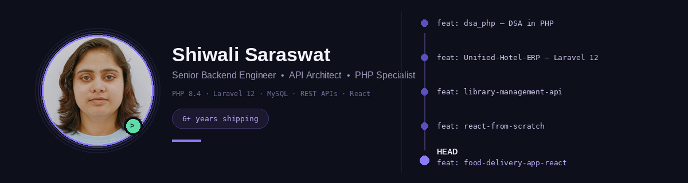

# Hi, I'm Shiwali Saraswat 👋

**Senior Backend Engineer · API Architect · PHP / Laravel Specialist**

6+ years building production-grade backend systems, payment integrations, and scalable APIs. Currently expanding into React on the frontend.

> 🟢 **Open to work:** PHP / Laravel Developer and Tech Lead roles, Noida · Delhi · Gurgaon, with remote, hybrid, and international options.

---

### 📈 Impact From Production Work

Most of my professional work lives in private repositories, so GitHub can't show it. Here is what it looked like:

- **15+ production systems** delivered end to end as the sole backend developer
- **SQL optimization:** cut a critical query from **~90s to ~13s**
- **Process automation:** reduced a manual workflow from **6 hours to 20 minutes**
- **Data pipeline:** built a **10M+ record** import pipeline for an OpenCart-based store
- **Marketplace:** built a multivendor marketplace with payment integrations
- **Microservices:** introduced Lumen-based services to the team's stack
- **Upgrades:** led Laravel version upgrades from **5.x to 8**
- **Payments & auth:** Stripe, Braintree, and PayPal integrations, plus OAuth2, Passport, Sanctum, and JWT

---

### 🛠 Tech Stack

**Core (daily, production-proven)**

**Also worked with**

**Currently learning**

---

### 🚀 Featured Projects

#### [Library Management API](https://github.com/shiwali-saraswat-dev/library-management-api) · 🚧 In progress

*A RESTful Laravel 12 API for a library's catalog, members, borrowing workflow, reservations, and fines.*

- **Built:** Auth, Category, Author, and Book modules
- **Architecture:** Controller → Service → Repository → Policy → Resource layering, with centralized error handling
- **Security:** Sanctum authentication and a four-tier RBAC hierarchy (owner → admin → librarian → member) via spatie/laravel-permission
- **API design:** cursor pagination, role-aware HATEOAS links, OpenAPI docs via l5-swagger
- **In progress:** Member module
- **Roadmap:** borrowing, reservations, fines, concurrency-safe transactions, idempotent writes

`PHP 8.3` `Laravel 12` `MySQL` `Sanctum` `OpenAPI`

#### [Unified Hotel ERP](https://github.com/shiwali-saraswat-dev/Unified-Hotel-ERP)

*A hospitality management suite built to demonstrate modern Laravel 12 patterns.*

- **Modules:** Guest PMS (room booking), POS (food ordering), and BMS (banquet management)
- **Modernization:** migrated from Laravel 8 to Laravel 12 using PHP 8.x features
- **Security:** role-based access control with Laravel Breeze for secure administration
- **Data integrity:** soft and permanent delete workflows with strict validation across modules
- **UX:** custom pagination, dynamic asset loading, and real-time notifications via SweetAlert2 / Toastr

`Laravel 12` `Blade` `MySQL` `Tailwind CSS`

#### [Food Delivery App (React)](https://github.com/shiwali-saraswat-dev/food-delivery-app-react) · 🆕

*Applying React fundamentals to a real-world ordering flow: restaurant listing, menus, and routing.*

<!-- Add the live demo link here once it is deployed:
🔗 [Live demo](https://shiwali-saraswat-dev.github.io/food-delivery-app-react/) -->

`React` `React Router` `JavaScript` `Parcel`

#### [DSA in PHP](https://github.com/shiwali-saraswat-dev/dsa_php)

*Data structures, algorithms, and problem-solving patterns in PHP, organized by topic, for backend interview preparation.*

`PHP`

#### [React From Scratch](https://github.com/shiwali-saraswat-dev/react-from-scratch)

*A self-paced React learning log, from plain HTML and vanilla JS through JSX, functional components, and composition.*

`React` `Vite` `Parcel` `JavaScript`

---

### 🌱 What I'm Working On

- Finishing the Member module and borrowing workflow in the Library Management API
- Building out React skills through small, real-world projects
- Practicing data structures and algorithms in PHP

---

### 📊 Languages

---

*Specialized in Backend Architecture · API Development · Laravel Ecosystem. Growing into React.*
